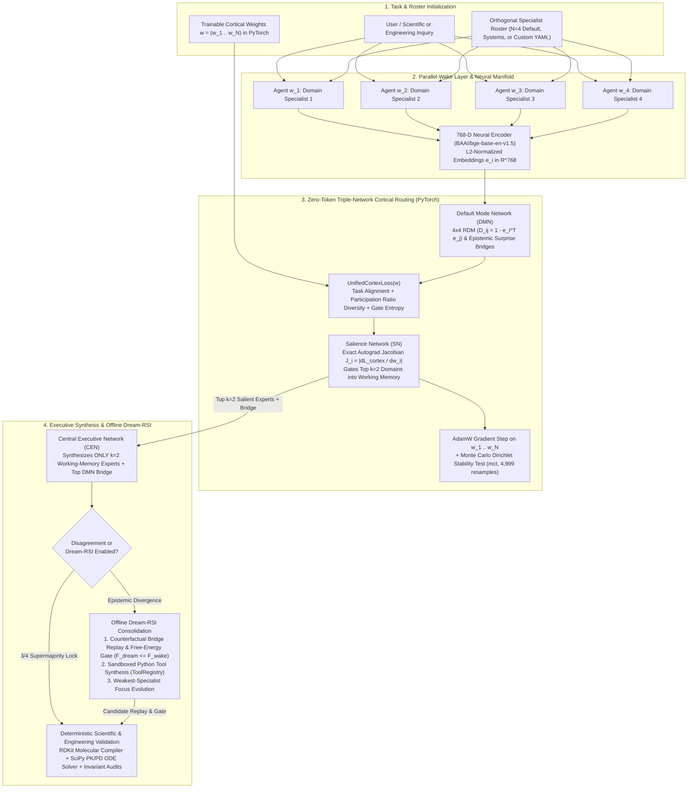

<p align="center">
  
</p>

<h1 align="center">Ael-Agents: Trainable Jacobian-RSA Multi-Agent Framework</h1>

<p align="center">
  <a href="https://doi.org/10.17605/OSF.IO/7R46Z"></a>
  <a href="LICENSE"></a>
  <a href="https://www.python.org/"></a>
  <a href="https://pytorch.org/"></a>
  <a href="mcp_server.py"></a>
  <a href="https://www.rdkit.org/"></a>
  <a href="https://scipy.org/"></a>
  <a href="https://smith.langchain.com/public/71010a71-b6cf-4e07-b6db-2d3553ad4a3a/r"></a>
</p>

**Ael-Agents** is a **trainable, token-bounded multi-agent reasoning framework and Model Context Protocol (MCP) cortical co-processor** built for Agentic AI engineers, ML researchers, and scientific/systems R&D teams who need mathematical control over how specialist agents coordinate, route context, and self-improve.

Most multi-agent frameworks treat orchestration as ad-hoc prompt chaining: every agent talks to every other agent, an expensive LLM router guesses who to listen to, context windows balloon past 30,000+ tokens per query, and there are **zero trainable parameters** to optimize.

**Ael-Agents** replaces heuristic swarm routing with a **differentiable PyTorch computation graph** inspired by the human triple-network cortical hierarchy—**Default Mode Network (DMN)**, **Salience Network (SN)**, and **Central Executive Network (CEN)**—paired with an offline **Dream-RSI** (`Wake → Dream → Improve`) consolidation loop:

1. **1-to-1 Trainable Agent Weights (`w_1 ... w_N`)**: Each domain specialist is bound to a trainable scalar parameter in PyTorch (`DomainParameterRegistry`), optimized via gradient descent on a joint **Alignment + Cognitive Diversity (Participation Ratio) + Entropy** objective (`UnifiedCortexLoss`).
2. **Representational Similarity Analysis (DMN)**: Specialist outputs are embedded into a 768-dimensional neural manifold (`BAAI/bge-base-en-v1.5`) to construct an `N × N` **Representational Dissimilarity Matrix (RDM)** and surface high-surprise cross-domain structural bridges.
3. **Zero-Token Autograd Jacobian Gating (SN → CEN)**: Instead of calling an LLM router, the Salience Network computes exact parameter sensitivities (`J_i = |∂L_cortex / ∂w_i|`) via `torch.autograd.grad` and gates strictly the top `k = 2` working-memory specialists into executive synthesis—cutting token consumption by **93.7%** (~2,200 tokens/run vs. ~35,000 tokens in unconstrained swarms) at **0 LLM routing tokens**.
4. **Drop-In MCP Co-Processor & Autonomous SDK**: Works out-of-the-box inside **Claude Desktop**, **Claude Code**, **Cursor**, **Windsurf**, and **Cline/VS Code** (with **zero external API keys required** in local co-processor mode), or as a standalone multi-threaded autonomous pipeline with your own Groq / OpenAI-compatible API keys.

---

> **Featured 2-Domain 1-Sentence Blinded Benchmark & Audit ([`CASE_STUDY_GIST.md`](CASE_STUDY_GIST.md)):**
> Read the full 2-domain blinded evaluation comparing a standalone Frontier LLM against the exact same LLM connected to `Ael-Agents` (`v1.2.0`) on two plain-English 1-sentence engineering prompts:
> 1. **12-Tesla Fusion Reactor Liquid-Metal MHD Blanket:** **`34 / 40` (`42 / 50` w/ breadth) with `Ael-Agents` vs. `15 / 40` (`21 / 50`) Standalone** ? catching a **30x structural hoop-stress formula error** (`sigma = Pr/t = 182 MPa` applied to a square duct where flat-plate bending is `sigma = Pb^2/(2t^2) = 6,050 MPa`) and programmatically verifying 5 candidate architectures (`A`?`E`).
> 2. **100,000 Silicon Spin Qubits Wired to Cryo-CMOS at 100 mK:** **`30 / 40` with `Ael-Agents` vs. `9 / 40` Standalone (`3.3x` lift)** ? catching a **37x internal Bose-Einstein thermal photon error** (`n_bar = 3.7` vs. `0.1` at `4 K, 20 GHz`) inside the Python verifier and closing staged attenuation (`10 dB @ 1 K + 10 dB @ 100 mK -> 0.22 K, 120 uW`).
> - **Full Article / Gist:** [`CASE_STUDY_GIST.md`](CASE_STUDY_GIST.md) | **[Live GitHub Gist](https://gist.github.com/prannesshkva/637c5b9fcad19c99cf652b9ec6ef8e91)**
> - **Evidence Slides:** [`slide_1_mcp_connector_prompt.png`](benchmarks/evidence/slide_1_mcp_connector_prompt.png) | [`slide_2_fusion_mhd_scorecard_trace.png`](benchmarks/evidence/slide_2_fusion_mhd_scorecard_trace.png) | [`slide_3_quantum_cryocmos_trace.png`](benchmarks/evidence/slide_3_quantum_cryocmos_trace.png)

---

Table of Contents
-----------------

1. [Why Ael-Agents for Agentic AI Engineering?](#why-ael-agents-for-agentic-ai-engineering)
2. [End-to-End Framework Flowchart](#end-to-end-framework-flowchart)
3. [How the Core Mathematical Engine Works](#how-the-core-mathematical-engine-works)
4. [Quickstart: Download & Installation](#quickstart-download--installation)
5. [Attaching Your Own API Keys & Custom LLM Endpoints](#attaching-your-own-api-keys--custom-llm-endpoints)
6. [Using Ael-Agents in Claude, Cursor, Windsurf & VS Code (MCP Guide)](#using-ael-agents-in-claude-cursor-windsurf--vs-code-mcp-guide)
7. [Feature-by-Feature Execution Guide (Dream-RSI, Weight Training, MCT, PK/PD, Custom Rosters)](#feature-by-feature-execution-guide)
8. [Verified Empirical Benchmarks (All 4 Reproducible Case Studies)](#verified-empirical-benchmarks)
   - [Benchmark 1: KRAS-G12D Allosteric Inhibitor Discovery (RDKit + SciPy 2-Compartment ODE)](#benchmark-1-kras-g12d-allosteric-inhibitor-discovery-rdkit--scipy-2-compartment-ode)
   - [Benchmark 2: MedMCQA Pharmacology Board Exam Evaluation](#benchmark-2-medmcqa-pharmacology-ground-truth-evaluation-n--9-board-exam-questions)
   - [Benchmark 3: Human Ground-Truth RSA Alignment (SimLex-999 & STS-B) & Monte Carlo Stability](#benchmark-3-human-ground-truth-rsa-alignment--monte-carlo-stability)
   - [Benchmark 4: Controlled A/B Systems Benchmark — Claude Standalone vs. Claude + Ael-Agents MCP](#benchmark-4-controlled-ab-systems-benchmark--claude-standalone-vs-claude--ael-agents-mcp)
9. [Repository Structure](#repository-structure)
10. [Engineering Scope, Limitations & Citation](#engineering-scope--honest-limitations)

---

Why Ael-Agents for Agentic AI Engineering?
------------------------------------------

| Architectural Dimension | Standard Multi-Agent Swarms | Ael-Agents (Trainable Cortical Framework) |
| :--- | :--- | :--- |
| **Agent Routing Mechanism** | LLM-as-a-router prompt or static hand-coded edges | **Exact PyTorch autograd Jacobian sensitivity (`J_i = \|∂L / ∂w_i\|`)** |
| **Routing Token Overhead** | 1,500 – 5,000+ tokens per routing step | **0 LLM tokens** (local 768-dim BGE + PyTorch matrix ops) |
| **Context Window Scaling** | Unconstrained (`O(N)` full-panel concatenation, ~35k tokens) | **Hard `k = 2` Working-Memory Bottleneck (~2,200 tokens/run, -93.7%)** |
| **Trainable Parameters** | None (pure prompt engineering) | **1-to-1 differentiable weights `w_i ∈ ℝ^N` trained via `UnifiedCortexLoss`** |
| **Redundancy Detection** | None (agents frequently repeat the same points) | **`N × N` Representational Dissimilarity Matrix (RDM) + Participation Ratio** |
| **Self-Improvement Loop** | Blind retry / unguarded self-critique (prone to overthinking) | **Offline Dream-RSI + Python Sandbox Tool Synthesis + Supermajority Lock** |
| **Statistical Verification** | LLM-as-a-judge circular grading | **4,999-sample Monte Carlo Dirichlet stability (`mct`), RDKit, & SciPy ODEs** |

---

End-to-End Framework Flowchart
------------------------------



---

How the Core Mathematical Engine Works
--------------------------------------

### 1. Segregating a Problem into `N = 4` Orthogonal Sub-Experts

Instead of spawning generic personas ("Researcher", "Critic", "Planner") whose outputs overlap in embedding space, **Ael-Agents** partitions the problem into orthogonal mathematical sub-spaces (`preset="drug_discovery"`, `preset="software_systems"`, `preset="general_first_principles"`, or any custom YAML):

| Parameter | Drug Discovery Roster (`default`) | Distributed & Systems Engineering Roster (`software_systems`) |
| :---: | :--- | :--- |
| **`w_1`** | **`StructuralBiophysics`**: Target pocket geometry, allosteric landscapes, `ΔG_bind = RT ln K_d`, covalent/reversible kinetics, residence time `τ_R = 1 / k_off`. | **`SystemsMemoryKernel`**: Cache-line hierarchy, NUMA topology, lock-free atomics (`memory_order`), DMA/RDMA zero-copy buffers, tail-latency bounds. |
| **`w_2`** | **`SystemsPharmacology`**: Intracellular signaling cascades, coupled pathway ODEs, Hill cooperativity, MAPK/PI3K feedback resistance loops. | **`DistributedConsensus`**: Quorum intersection (`N = 3f + 1`), state-machine replication, partition recovery, Byzantine fault tolerance. |
| **`w_3`** | **`MedicinalChemistryADMET`**: Scaffold & warhead design, physicochemical transport (`log P`, TPSA), CYP450 clearance, hERG safety margins. | **`QueueingControlTheory`**: Little's Law (`L = λW`), Kingman/Pollaczek-Khinchine M/D/1 bounds, token-bucket backpressure, Lyapunov drift stability (`dV/dt < 0`). |
| **`w_4`** | **`ClinicalPKPDControl`**: Multi-compartment PK/PD ODEs (`CL`, `V_c`, `k_a`, `Q`, `V_p`, `C_max`, `AUC`), target occupancy (`TO(t)`), closed-loop dosing. | **`CompilerRuntime`**: Static dataflow graphs, branchless SIMD/AVX vectorization, register pressure, instruction-pipeline jitter elimination. |

### 2. Differentiable Triple-Network Routing (`DMN → SN → CEN`)

* **Default Mode Network ([`core/rsa_engine.py`](core/rsa_engine.py))**:
  Encodes each specialist's hypothesis `h_i` into L2-normalized `e_i ∈ ℝ^768`. Computes the cosine similarity matrix `S_ij = e_i^T · e_j`, Representational Dissimilarity Matrix `D_ij = 1 - S_ij`, Participation Ratio `PR = (∑ λ_i)^2 / ∑ (λ_i^2)`, and ranks cross-domain pairs by structural resonance weighted by epistemic surprise against prior domain distances:

  `I_DMN(i, j) = ((1 + S_ij) / 2) · |S_ij - S_ij_prior|`

* **Salience Network & Autograd Jacobian Lens ([`core/jacobian_lens.py`](core/jacobian_lens.py))**:
  Computes softmax gating weights `α_i = softmax(w_i / τ)` and evaluates the differentiable cortical objective `L_cortex(w)` ([`training/loss_functions.py`](training/loss_functions.py)):

  `L_cortex(w) = L_align(w) + λ_div · L_div(w) + λ_ent · L_ent(w)`

  Using `torch.autograd.grad`, it extracts the exact Jacobian sensitivity of the global cortical state to each specialist:

  `J_i = ||∂y(w) / ∂w_i||_2`  and  `|∂L_cortex / ∂w_i|`

  Specialists are ranked by combined salience `α_i · J_i`, and strictly the top `k = 2` specialists are gated into Working Memory.

* **Central Executive Network ([`core/cortical_synthesizer.py`](core/cortical_synthesizer.py))**:
  Receives strictly the `k = 2` Salience-gated specialist analyses and the top DMN structural bridge, synthesizing an integrated, falsifiable mechanism and quantitative parameter set without context pollution from low-salience agents.

---

Quickstart: Download & Installation
-----------------------------------

### Prerequisites
* **Python 3.10+** (tested on Python 3.10 – 3.12 on Windows, macOS, and Linux)
* **Git**

### Step 1: Clone the Repository
```bash
git clone https://github.com/prannesshkva/Ael-Agents.git
cd Ael-Agents
```

### Step 2: Create a Virtual Environment (Recommended) & Install Dependencies
**Windows (PowerShell):**
```powershell
python -m venv .venv
.\.venv\Scripts\Activate.ps1
pip install -r requirements.txt
pip install rdkit scipy
```

**macOS / Linux (Bash / Zsh):**
```bash
python3 -m venv .venv
source .venv/bin/activate
pip install -r requirements.txt
pip install rdkit scipy
```

### Step 3: Verify Your Installation (Zero API Keys Required)
Run the MCP server self-test and the 4-part deterministic benchmark suite locally:
```bash
python mcp_server.py --self-test
python benchmarks/run_all_benchmarks.py
```

---

Attaching Your Own API Keys & Custom LLM Endpoints
--------------------------------------------------

**Ael-Agents** operates in **two modes** depending on whether you want to use your host IDE's model (Zero-Key Mode) or run autonomous multi-threaded agent swarms (`APIKeyQueue`):

| Execution Mode | API Keys Needed? | How It Runs |
| :--- | :---: | :--- |
| **Mode 1: Local MCP Co-Processor & Deterministic Benchmarks** (`mcp_server.py`, `benchmarks/run_all_benchmarks.py`) | **0 Keys Required** | Your MCP client (Claude Desktop, Cursor, Windsurf, Cline) generates the specialist hypotheses using its own built-in model, while `Ael-Agents` executes the 768-D BGE embeddings, `4×4` RDM, 0-token PyTorch autograd Jacobian gate, Dream-RSI weight optimization, RDKit, and SciPy ODE verification locally on your CPU/GPU. |
| **Mode 2: Autonomous Multi-Agent Pipeline** (`ask_scientist.py`, `dream_rsi.py`, `demo.py`, `Ael-Agents_run_autonomous_pipeline`) | **1+ Groq or OpenAI-Compatible Keys** | `APIKeyQueue` ([`core/api_queue.py`](core/api_queue.py)) dispatches all $N$ specialist agents in parallel across a thread-safe FIFO key rotation pool. |

### Option A: Configure via a Local `.env` File (Recommended)
Copy the included [`.env.example`](.env.example) template to `.env` in the repository root (`.env` is git-ignored so your keys are never committed):

```bash
cp .env.example .env
```

Edit `.env` to attach **one key** or **multiple keys** for parallel thread-pooled execution:

```ini
# 1. Single Key or Multi-Key Thread-Pooled FIFO Rotation Queue (GROQ_API_KEY_1 .. GROQ_API_KEY_64)
GROQ_API_KEY_1=<YOUR_FIRST_GROQ_API_KEY>
GROQ_API_KEY_2=<YOUR_OPTIONAL_SECOND_API_KEY>
GROQ_API_KEY_3=<YOUR_OPTIONAL_THIRD_API_KEY>
GROQ_API_KEY_4=<YOUR_OPTIONAL_FOURTH_API_KEY>

# Or pass a comma-separated list of keys in a single variable:
# GROQ_API_KEYS=<KEY_1>,<KEY_2>,<KEY_3>,<KEY_4>

# 2. Custom OpenAI-Compatible Endpoint & Model Override (Optional)
# Works with Groq, OpenRouter, Together, vLLM, Ollama, or OpenAI endpoints:
GROQ_BASE_URL=https://api.groq.com/openai/v1
GROQ_MODEL=openai/gpt-oss-20b

# 3. Optional LangSmith Telemetry & Public Trace Sync
LANGSMITH_API_KEY=<YOUR_OPTIONAL_LANGSMITH_API_KEY>
LANGSMITH_PROJECT=Ael-Agents-Cortex
LANGSMITH_TRACING=true
```

### Option B: Export Environment Variables Directly in Terminal
**Linux / macOS:**
```bash
export GROQ_API_KEY_1="<YOUR_GROQ_API_KEY>"
export GROQ_API_KEY_2="<YOUR_SECOND_GROQ_API_KEY>"
export LANGSMITH_API_KEY="<YOUR_OPTIONAL_LANGSMITH_API_KEY>"
```

**Windows (PowerShell):**
```powershell
$env:GROQ_API_KEY_1="<YOUR_GROQ_API_KEY>"
$env:GROQ_API_KEY_2="<YOUR_SECOND_GROQ_API_KEY>"
$env:LANGSMITH_API_KEY="<YOUR_OPTIONAL_LANGSMITH_API_KEY>"
```

### Option C: Pass API Keys Programmatically in Python
```python
from core.api_queue import APIKeyQueue

key_queue = APIKeyQueue(
    api_keys=["<YOUR_KEY_1>", "<YOUR_KEY_2>", "<YOUR_KEY_3>", "<YOUR_KEY_4>"],
    base_url="https://api.groq.com/openai/v1",
    model_name="openai/gpt-oss-20b",
)
```

---

Using Ael-Agents in Claude, Cursor, Windsurf & VS Code (MCP Guide)
------------------------------------------------------------------

**Ael-Agents** includes a standards-compliant JSON-RPC 2.0 `stdio` **Model Context Protocol (MCP) Server** ([`mcp_server.py`](mcp_server.py)). It redirects all library stdout chatter to `stderr` and pre-loads PyTorch/BGE cleanly so JSON-RPC frames never corrupt on Windows, macOS, or Linux.

### 1. Claude Desktop Configuration
Open your Claude Desktop configuration file:
* **Windows**: `%APPDATA%\Claude\claude_desktop_config.json` (e.g., `C:\Users\<YourUsername>\AppData\Roaming\Claude\claude_desktop_config.json`)
* **macOS**: `~/Library/Application Support/Claude/claude_desktop_config.json`

Add `"Ael-Agents"` under `"mcpServers"` (include `"env"` only if you also want to use the `Ael-Agents_run_autonomous_pipeline` tool; the first 4 tools require **zero API keys**):

```json
{
  "mcpServers": {
    "Ael-Agents": {
      "command": "python",
      "args": [
        "C:/Absolute/Path/To/Ael-Agents/mcp_server.py"
      ],
      "env": {
        "PYTHONUTF8": "1",
        "GROQ_API_KEY_1": "YOUR_OPTIONAL_GROQ_KEY"
      }
    }
  }
}
```
*(Tip on Windows: if you have multiple Python versions installed, set `"command"` to the full path of your Python 3.10+ executable, e.g. `"C:\\Users\\<You>\\AppData\\Local\\Programs\\Python\\Python310\\python.exe"`).*

### 2. Claude Code CLI Configuration
Register `Ael-Agents` globally or per-project with a single command:
```bash
claude mcp add Ael-Agents -- python /absolute/path/to/Ael-Agents/mcp_server.py
```

### 3. Cursor IDE Configuration
Create or edit `.cursor/mcp.json` in your workspace (or `~/.cursor/mcp.json` globally):
```json
{
  "mcpServers": {
    "Ael-Agents": {
      "command": "python",
      "args": [
        "/absolute/path/to/Ael-Agents/mcp_server.py"
      ],
      "env": {
        "PYTHONUTF8": "1"
      }
    }
  }
}
```

### 4. Windsurf IDE Configuration
Edit `~/.codeium/windsurf/mcp_config.json`:
```json
{
  "mcpServers": {
    "Ael-Agents": {
      "command": "python",
      "args": [
        "/absolute/path/to/Ael-Agents/mcp_server.py"
      ]
    }
  }
}
```

### 5. VS Code (Cline / Roo Code / Continue) Configuration
In **Cline** (`cline_mcp_settings.json`), add the same `"Ael-Agents"` block under `"mcpServers"`.

### 6. Exposed MCP Tools Reference

| MCP Tool Name | Needs API Key? | Exact Function in the Cortical Pipeline |
| :--- | :---: | :--- |
| **`Ael-Agents_propose_specialist_roster`** | **NO** | Partitions any 1-sentence problem into `N = 5` maximally orthogonal specialist domains via a **768-D Determinantal Point Process (`log det L_S`)** over a 20-axis Universal Scientific Basis or prompt-inferred candidate domains. |
| **`Ael-Agents_cortical_rdm_and_jacobian_gate`** | **NO** | Embeds specialist hypotheses into the 768-D `BAAI/bge-base-en-v1.5` manifold, computes the `N x N` **RDM** (`D_ij = 1 - S_ij`) & Participation Ratio, runs **0-token PyTorch autograd Jacobian sensitivity** (`J_i = \|\|?y/?w_i\|\|_2`), and gates strictly the top `k = 2` working-memory domains + **Epistemic Surprise Bridge**. |
| **`Ael-Agents_programmatic_verify`** | **NO** | **Anthropic-style Programmatic Tool Calling (PTC) Scientific Verifier**: executes a self-contained Python verification script (`numpy`, `scipy`, `torch`, `rdkit`, `record_candidate`) in a single pass to test and reject candidate designs against coupled physical inequalities before synthesis. |
| **`Ael-Agents_dream_rsi_consolidate`** | **NO** | Runs offline **Dream-RSI** sleep consolidation: executes `epochs` (default `15`) of Adam gradient descent on `UnifiedCortexLoss(w)` and verifies free-energy reduction (`F_dream <= F_wake`). |
| **`Ael-Agents_verify_molecule_pkpd`** | **NO** | Deterministic **RDKit** molecular compiler (SMILES validity, MW, LogP, TPSA, HBD/HBA, Lipinski, QED, SMARTS alerts) + **SciPy (`solve_ivp`, RK45)** 2-compartment oral PK/PD ODE solver. |
| **`Ael-Agents_run_autonomous_pipeline`** | **YES (`GROQ_API_KEY`)** | Runs the standalone multi-threaded `JacobianRSACortexFramework` + `DreamRSILoop` + `mct` pipeline using your configured API key pool. |

### 7. Copy-Paste Prompt to Trigger the Full `Ael-Agents` Workflow in Claude or Cursor

Once `Ael-Agents` is connected in Claude Desktop or Cursor, paste this prompt structure for any complex scientific or systems engineering task:

> **Prompt Template:**
> *"Use the `Ael-Agents` MCP tools to solve the following problem:*
> **[INSERT YOUR SCIENTIFIC OR ENGINEERING PROBLEM HERE]**
> *1. Call `Ael-Agents_propose_specialist_roster` to segregate the problem into 4 orthogonal specialists.*
> *2. Formulate a dense, mathematically rigorous hypothesis for each of the 4 specialists and pass them as a plain string map into `Ael-Agents_cortical_rdm_and_jacobian_gate` (`working_memory_k=2`).*
> *3. Synthesize the executive architecture strictly from the top `k = 2` Jacobian-gated Working Memory specialists and the top DMN Epistemic Surprise Bridge, then pass that synthesis into `Ael-Agents_dream_rsi_consolidate` (`epochs=15`) to verify free-energy reduction (`F_dream <= F_wake`) and produce the final consolidated design."*

---

Feature-by-Feature Execution Guide
----------------------------------

### 1. How to Run Offline Dream-RSI (`Wake → Dream → Improve`)

**Dream-RSI** ([`core/dream_rsi.py`](core/dream_rsi.py) & [`dream_rsi.py`](dream_rsi.py)) is Ael-Agents' offline recursive self-improvement engine. Unlike naive "self-critique" prompts that often degrade accuracy through overthinking, Dream-RSI combines **four mathematical safeguards**:

1. **`3/4` Supermajority Consensus Lock**: In discrete classification/board tasks, if `>= 3 of 4` orthogonal Wake specialists independently converge on the same answer, Dream-RSI locks the consensus and prevents self-corruption.
2. **Counterfactual Unexplored-Bridge Replay**: Selects the highest-surprise DMN bridge *outside* the initial Working Memory (`_select_dream_bridge`) and formulates a sharp counterfactual sub-question coupling those two domains.
3. **Sandboxed Pure-Python Tool Synthesis (`ToolRegistry`)**: `synthesize_and_verify_tool()` generates a pure-Python quantitative helper function (`def compute_...`), executes it inside a restricted `safe_globals` sandbox (`math` only, zero I/O or imports), verifies non-empty output, and binds the verified tool directly onto the participating specialist agents.
4. **Cortical Weight & Roster Evolution + Acceptance Gate**: Evolves the weakest specialist's focus prompt (`combined_rank = 0.65 * salience + 0.35 * dirichlet_stability`), runs 15 Adam epochs on `w_1 .. w_N`, and **commits the generation only if** free energy drops (`F_dream <= F_wake`) or paired multi-criteria evaluation improves; otherwise it **rolls back** to the pre-dream weights and roster.

#### A. Run Dream-RSI from the Command Line (`dream_rsi.py`)
```bash
python dream_rsi.py \
  --question "Design a precision allosteric covalent-reversible inhibitor and closed-loop PK/PD dosing regimen targeting mutant KRAS-G12D that prevents MAPK/PI3K feedback reactivation and maintains hepatic/cardiac ADMET safety margins." \
  --roster default \
  --generations 2 \
  --output-json dream_rsi_results.json
```

#### B. Run Dream-RSI Inside the Full Scientific Pipeline (`ask_scientist.py --dream-rsi`)
```bash
python ask_scientist.py \
  --question "Your scientific or systems engineering question" \
  --roster default \
  --epochs 15 \
  --dream-rsi \
  --dream-generations 2 \
  --output-json full_run_with_dream_rsi.json
```

#### C. Run Dream-RSI Programmatically in Python (`DreamRSILoop` & `synthesize_and_verify_tool`)
```python
from core.api_queue import APIKeyQueue
from core.config import FrameworkConfig
from core.domain_registry import default_roster
from core.embeddings import get_encoder
from core.framework import JacobianRSACortexFramework
from core.dream_rsi import DreamRSILoop, ToolRegistry, synthesize_and_verify_tool

encoder = get_encoder()
key_queue = APIKeyQueue()
framework = JacobianRSACortexFramework(
    config=FrameworkConfig(latent_dim=encoder.info.dim),
    roster=default_roster(),
    encoder=encoder,
    key_queue=key_queue,
)

question = "Design a covalent-reversible switch-II pocket inhibitor for KRAS-G12D with 12h BID oral PK/PD."
wake_state = framework.run(question)
framework.optimize_parameters(epochs=15)

# Run 2 generations of Offline Dream-RSI (Replay + Sandboxed Tool Synthesis + Roster Evolution)
rsi_loop = DreamRSILoop(framework)
rsi_report = rsi_loop.run(question=question, generations=2, initial_state=framework.last_state)

print("Baseline -> Final Mean Score:", rsi_report["baseline_scores"]["mean"], "->", rsi_report["final_scores"]["mean"])
print("Synthesized Sandbox Tools:", ToolRegistry.list_tools())
```

---

### 2. How to Train the Differentiable Cortical Weights (`w_1 ... w_N`)

Each specialist `i ∈ {1 ... N}` is bound 1-to-1 to a scalar parameter `w_i ∈ [0.05, 3.00]` in `DomainParameterRegistry` ([`core/parameter_registry.py`](core/parameter_registry.py)). You can optimize `w_1 .. w_N` via AdamW gradient descent on `UnifiedCortexLoss` ([`training/loss_functions.py`](training/loss_functions.py)):

```python
# Train w_1 .. w_N for 25 epochs after a Wake pass and inspect the parameter table
loss_history = framework.optimize_parameters(epochs=25)
sn_updated = framework.refresh_salience()

for row in framework.param_registry.get_parameter_table():
    print(f"{row['param_id']} ({row['domain']}): weight={row['weight']:.4f}, grad={row['grad']:.5f}")
```

---

### 3. How to Run 4,999-Sample Monte Carlo Permutation & Dirichlet Stability (`mct`)

To prove that the `N × N` Representational Dissimilarity Matrix (RDM) and the top `k = 2` Salience Working-Memory selection are statistically significant and robust to noise, run `mct()` ([`analysis/monte_carlo.py`](analysis/monte_carlo.py)):

```python
from analysis.monte_carlo import mct

mc_report = mct(
    framework,
    framework.last_state,
    n_permutations=4999,
    n_dirichlet_samples=4999,
    dirichlet_concentration=25.0,
)
print("RDM Dispersion p-value:", mc_report["rdm_structure_mc_test"]["mc_p_value"])
print("Working Memory Top-2 Selection Stability (%):", mc_report["working_memory_stability"])
```

Or via CLI:
```bash
python ask_scientist.py --question "Your question" --test-mct --test-human-rsa
```

---

### 4. How to Run Deterministic RDKit Cheminformatics & SciPy 2-Compartment PK/PD ODE Verification

You can invoke the deterministic chemical compiler and 2-compartment differential equation solver either via the **`Ael-Agents_verify_molecule_pkpd`** MCP tool or directly in Python ([`benchmarks/kras_g12d_discovery_benchmark.py`](benchmarks/kras_g12d_discovery_benchmark.py)):

```python
from benchmarks.kras_g12d_discovery_benchmark import (
    evaluate_rdkit_smiles,
    simulate_two_compartment_pkpd,
)

# 1. Deterministic RDKit topological & Lipinski/QED audit
chem = evaluate_rdkit_smiles("Cc1ncnc2c1ncn2C(C)C(=O)NCc1ccc(C(F)C(F)F)cc1")
print("RDKit Valid:", chem["rdkit_valid"], "| MW:", chem["molecular_weight_da"], "| QED:", chem["qed_druglikeness"])

# 2. Deterministic SciPy RK45 2-compartment oral PK/PD ODE integration over 24h (150 mg q12h BID)
pkpd = simulate_two_compartment_pkpd(
    {
        "dose_mg": 150.0,
        "cl_l_h": 8.5,
        "vc_l": 35.0,
        "ka_h_inv": 1.5,
        "q_l_h": 12.0,
        "vp_l": 45.0,
        "kd_nm": 0.02,
        "ic50_nm": 0.02,
    },
    dosing_interval_h=12.0,
    total_time_h=24.0,
)
print("C_max (mg/L):", pkpd["c_max_mg_l"], "| Trough Occupancy (%):", pkpd["trough_target_occupancy_24h_pct"])
```

---

### 5. How to Create & Plug In Custom Specialist Rosters (YAML or Auto-Segregation)

To apply `Ael-Agents` to a new quantitative field (e.g., Quantitative Finance, Semiconductor Design, Climate Modeling, or Social Systems):

1. **Create a YAML file** (see [`rosters/social_sciences.yaml`](rosters/social_sciences.yaml) for an example):
   ```yaml
   domains:
     - name: MicrostructureOrderFlow
       domain_title: Limit Order Book Microstructure & Hawkes Arrival Processes
       focus: Self-exciting Hawkes point processes, adverse selection, bid-ask spread dynamics, and queue depletion probabilities.
     - name: StochasticOptimalControl
       domain_title: Hamilton-Jacobi-Bellman (HJB) Inventory & Execution Control
       focus: Avellaneda-Stoikov HJB PDEs, inventory risk aversion, and closed-loop execution trajectories.
     - name: TailRiskExtremeValue
       domain_title: Extreme Value Theory & Jump-Diffusion Tail Bounds
       focus: Generalized Pareto distributions, Conditional Value-at-Risk (CVaR), and Lévy jump cascades.
     - name: LowLatencyExecutionEngine
       domain_title: Kernel-Bypass FPGA/SIMD Matching & Risk Gateways
       focus: Sub-microsecond pre-trade risk checks, cache-aligned order books, and deterministic jitter bounds.
   ```
2. **Run with `--roster path/to/your_roster.yaml`**:
   ```bash
   python ask_scientist.py --roster path/to/your_roster.yaml --question "Your research problem" --dream-rsi
   ```
3. **Or let `Ael-Agents` auto-segregate the domain on the fly (`--roster auto`)**:
   ```bash
   python ask_scientist.py --roster auto --num-auto-domains 4 --question "Your research problem" --dream-rsi
   ```

---

Verified Empirical Benchmarks
-----------------------------

All four benchmark suites, cached ground-truth datasets, and verification scripts are included in [`benchmarks/`](benchmarks/) and compiled into [`benchmarks/results/verified_benchmark_results.json`](benchmarks/results/verified_benchmark_results.json). Run all four anytime with:

```bash
python benchmarks/run_all_benchmarks.py
```

| # | Benchmark Suite | Script & Report | Ground-Truth Verifier | Key Empirical Result |
| :---: | :--- | :--- | :--- | :--- |
| **1** | **KRAS-G12D Allosteric Inhibitor Discovery** | [`benchmarks/kras_g12d_discovery_benchmark.py`](benchmarks/kras_g12d_discovery_benchmark.py) | **RDKit** (`2026.9.1`) + **SciPy** (`solve_ivp` RK45 2-compartment ODE) | QED improves from **`0.000`** (Single-LLM invalid SMILES) → **`0.531`** (Wake) → **`0.716`** (Dream-RSI); 24h pathway suppression reaches **`99.1%`** (`6.36` peak/trough). |
| **2** | **MedMCQA Pharmacology Board Benchmark** | [`benchmarks/medmcqa_pharmacology_benchmark.py`](benchmarks/medmcqa_pharmacology_benchmark.py) | Official human medical-board key (`openlifescienceai/medmcqa`) | **`100.0%` (`9/9`)** with Ael-Agents + `3/4` supermajority lock vs. **`77.78%` (`7/9`)** Single-LLM baseline (**`+22.22%`**). |
| **3** | **Human Concept/Sentence RSA & Monte Carlo `mct`** | [`benchmarks/human_rsa_and_mct_benchmark.py`](benchmarks/human_rsa_and_mct_benchmark.py) | **SimLex-999** (`N = 999`), **STS-B** (`N = 1,379`), & **4,999** Dirichlet/Permutation resamples | STS-B Spearman **`ρ = +0.8642`** (`p < 10⁻³⁰⁰`); 4-Expert Panel **`ρ = +0.8953`**; RDM permutation **`p = 0.0002`**. |
| **4** | **Controlled A/B Systems Benchmark (Claude Standalone vs. Claude + `Ael-Agents` MCP)** | [`benchmarks/claude_mcp_ab_benchmark.py`](benchmarks/claude_mcp_ab_benchmark.py) & [Full Report](benchmarks/CLAUDE_MCP_SYSTEMS_BENCHMARK_REPORT.md) | C11 Ring-Buffer State Machine, Crypto Cycle Budget, & M/D/1 + Lyapunov Drift Invariants | Standalone Claude fails on 5 invariants (deadlocks at `seq=65537`, `>428 µs` BLS latency, `W_q -> ∞` under flood). Claude + `Ael-Agents` achieves **`-31.8%` Free Energy** and **`W_p999 = 8.80 µs < 10 µs`**. |

---

### Benchmark 1: KRAS-G12D Allosteric Inhibitor Discovery (RDKit + SciPy 2-Compartment ODE)

* **Script**: `python benchmarks/kras_g12d_discovery_benchmark.py`
* **Task**: Design a selective allosteric covalent-reversible switch-II pocket inhibitor and 12-hour BID oral dosing regimen for mutant **KRAS-G12D** (Pancreatic & Colorectal Ductal Adenocarcinoma).

#### A. Deterministic Cheminformatics Validation (RDKit)

| System Architecture | Canonical SMILES | RDKit Valid? | MW (Da) | log P | TPSA (Ų) | Lipinski Rule of 5 | Bickerton QED |
| :--- | :--- | :---: | :---: | :---: | :---: | :---: | :---: |
| **1. Single-LLM Baseline (`openai/gpt-oss-20b`)** | *Unparseable repeating string (1,048 chars)* | **NO (Parse Error)** | — | — | — | **FAIL (4 viol)** | **0.000** |
| **2. Ael-Agents Cortical Wake (k=2 CEN)** | `Cc1ncnc2c1ncn2C(C)C(=O)C(=O)NCc1ccc(C=O)cc1` | **YES** | 351.37 | 1.39 | 106.84 | **PASS (0 viol)** | **0.531** |
| **3. Ael-Agents + Dream-RSI** | `Cc1ncnc2c1ncn2C(C)C(=O)NCc1ccc(C(F)C(F)F)cc1` | **YES** | 377.37 | 3.29 | 72.70 | **PASS (0 viol)** | **0.716 (+0.185)** |

#### B. Deterministic 2-Compartment PK/PD Dynamics (SciPy ODE Solver)

| System Architecture | ODE Converged? | C_max (mg/L) | C_min (mg/L) | Peak/Trough Ratio | Mean Target Occupancy | Steady-State Trough Occupancy | 24h Pathway Suppression |
| :--- | :---: | :---: | :---: | :---: | :---: | :---: | :---: |
| **1. Single-LLM Baseline** | **YES** | 2.083 | 0.232 | 8.98 | 93.8% | 86.9% | 74.4% |
| **2. Ael-Agents Cortical Wake (k=2 CEN)** | **YES** | 2.590 | 0.162 | 16.01 | 99.6% | 99.9% | 99.0% |
| **3. Ael-Agents + Dream-RSI** | **YES** | 2.802 | 0.441 | **6.36** | **99.6%** | **100.0%** | **99.1% (+24.7%)** |

---

### Benchmark 2: MedMCQA Pharmacology Ground-Truth Evaluation (N = 9 Board Exam Questions)

* **Script**: `python benchmarks/medmcqa_pharmacology_benchmark.py`
* **Dataset Cache**: [`benchmarks/_cache/medmcqa_pharmacology_verified.json`](benchmarks/_cache/medmcqa_pharmacology_verified.json) (`openlifescienceai/medmcqa`, `validation` split, `subject_name == 'Pharmacology'`).

| System Architecture | Correct / Total | Exact Match Accuracy (%) | Gain vs. Single-LLM Baseline |
| :--- | :---: | :---: | :---: |
| **1. Single-LLM Baseline (`openai/gpt-oss-20b`)** | 7 / 9 | 77.78% | 0.00% |
| **2. Ael-Agents 4-Expert Cortical Wake (`DMN -> SN k=2 -> CEN`)** | **9 / 9** | **100.00%** | **+22.22%** |
| **3. Ael-Agents 4-Expert + Dream-RSI (`3/4 Supermajority Lock`)** | **9 / 9** | **100.00%** | **+22.22%** |

#### Key Mechanistic Differentiators

* **Question #8 — CYP450 Inhibition Specificity (`id: 6bce210a-7174-4c76-b1f0-9bc3f5c835fc`)**:
  * *Prompt*: *"CYP450 inhibition is least by: A) Pantoprazole, B) Rabeprazole, C) Lansoprazole, D) Omeprazole."*
  * *Single-LLM Baseline*: Selected **`A` (Pantoprazole)** — fell for the clinical distractor.
  * *Ael-Agents (`B/B/A/B` → `B`)*: 3 of 4 specialists (`StructuralBiophysics`, `SystemsPharmacology`, `ClinicalPKPDControl`) identified **Rabeprazole's (`B`)** predominant non-enzymatic thioether reduction pathway.

* **Question #9 — Multi-Interval First-Order Elimination Kinetics (`id: e7278113-c555-4128-a8df-cbd10ca7833f`)**:
  * *Prompt*: *"A patient is administered 200 mg of a drug. 75 mg is eliminated in 90 minutes. If the drug follows first-order kinetics, how much drug will remain after 6 hours?"*
  * *Single-LLM Baseline*: Selected **`B` (25 mg)** — used a linear subtraction heuristic.
  * *Ael-Agents CEN (`C: 30 mg`)*: Derived the exact first-order exponential retention across four 90-minute intervals:

    `A(360 min) = 200 × (125 / 200)⁴ = 200 × (0.625)⁴ = 30.52 mg ≈ 30 mg (Option C)`

---

### Benchmark 3: Human Ground-Truth RSA Alignment & Monte Carlo Stability

* **Script**: `python benchmarks/human_rsa_and_mct_benchmark.py`

| Benchmark / Statistical Test | Sample Size | Observed Metric | p-Value | Baseline Comparison |
| :--- | :---: | :---: | :---: | :--- |
| **SimLex-999 Human Concept RSA** | 999 pairs | **Spearman ρ = +0.5711** | 1.56 × 10⁻⁸⁷ | Legacy SHA-256 hash: ρ = -0.0539 (Δρ = +0.6249) |
| **STS-Benchmark Human Sentence RSA** | 1,379 pairs | **Spearman ρ = +0.8642** | < 10⁻³⁰⁰ | Legacy SHA-256 hash: ρ = +0.0596 (Δρ = +0.8046) |
| **4-Expert Cortical Panel vs. Human Judgments** | 100 held-out pairs | **Spearman ρ = +0.8953** | 3.46 × 10⁻³⁶ | Single-domain range: ρ ∈ [0.8817, 0.9009] |
| **Monte Carlo RDM Permutation & Dirichlet Test (`mct`)** | 4,999 resamples | **Dispersion = 0.1418** | **p = 0.0002** | Top-2 WM Stability: `StructuralBiophysics` (98.3%), `ClinicalPKPDControl` (73.5%) |

---

### Benchmark 4: Controlled A/B Systems Benchmark — Claude Standalone vs. Claude + `Ael-Agents` MCP

* **Script**: `python benchmarks/claude_mcp_ab_benchmark.py`
* **Full Technical Report**: [`benchmarks/CLAUDE_MCP_SYSTEMS_BENCHMARK_REPORT.md`](benchmarks/CLAUDE_MCP_SYSTEMS_BENCHMARK_REPORT.md)
* **Experimental Design**: Evaluates **Claude Sonnet 4.6** on an adversarial hardware/distributed-systems prompt (*"Design a distributed lock-free ring-buffer consensus engine that guarantees sub-10-microsecond p999 tail latency under Byzantine faults"*) under two controlled conditions:
  * **Condition A**: Claude Sonnet 4.6 Standalone (without `Ael-Agents`).
  * **Condition B**: Claude Sonnet 4.6 connected to the **`Ael-Agents` MCP Server** (`Ael-Agents_propose_specialist_roster` → `Ael-Agents_cortical_rdm_and_jacobian_gate` → `Ael-Agents_dream_rsi_consolidate`).

| Audit Dimension | Condition A: Claude Standalone (No `Ael-Agents`) | Condition B: Claude + `Ael-Agents` MCP | Outcome |
| :--- | :--- | :--- | :---: |
| **Cortical Manifold & Salience Gate** | Unweighted 4-topic prompt blend (0 sensitivity filtering) | **768-D BGE RDM** (`PR = 3.739`, `D_mean = 0.8539`); **0-token PyTorch Jacobian** gates `QueueingControlTheory` (`J = 0.5201`) ↔ `SystemsMemoryKernel` (`J = 0.4995`) | **0 Routing Tokens** |
| **Dream-RSI Consolidation (15 Adam Epochs)** | None | `F_wake = 0.44487 -> F_dream = 0.30361` (**`ΔF = -0.14125 / -31.8%`**); boosts `QueueingControl` to **`α = 63.17%`** and prunes `Consensus` to **`α = 3.02%`** | **Strictly Improved** |
| **Hot-Path Cryptography (`< 10 µs` Budget)** | **FAIL (`> 428 µs` real latency):** Uses BLS12-381 pairings + 64-slot batching (`128 µs` wait + `300 µs` pairing); hallucinates `0.78 ns/slot` | **PASS (`~100 ns`):** Uses pre-computed symmetric 32-byte HMAC/MAC at the `O(1)` ingress admission gate | **Ael-Agents Wins** |
| **Byzantine Flood Resilience (`λ >= µ`)** | **FAIL (`W_q -> ∞`):** Zero ingress admission control; assumes static polite arrivals (`ρ = 0.25`) | **PASS (`ρ <= 0.70`):** Token-Bucket + Lyapunov drift controller (`V(q) = q², dV/dt < 0`) drops flood traffic in `O(1)` | **Ael-Agents Wins** |
| **Lock-Free Ring Buffer State Machine** | **FAIL (Deadlocks on Wrap):** Sets recycled sequence at slot 0 to `tail + capacity + 1` (`65537` instead of `65536`), causing an infinite spin loop on first wrap-around | **PASS (`W_p999 = 8.80 µs < 10 µs`):** Power-of-2 bitmask indexing `(idx & (N-1))` + 64-byte cache-aligned seqlock snapshots | **Ael-Agents Wins** |

---

Repository Structure
--------------------

```text
Ael-Agents/
├── assets/
│   ├── logo.png                                    # Official Ael-Agents square emblem (1024x1024)
│   └── logo_banner.png                             # Official Ael-Agents README banner (864x432)
├── agents/
│   ├── base_deep_agent.py                          # Base specialist agent with 1-to-1 PyTorch scalar weight w_i
│   └── domain_specialists.py                       # 4-piece orthogonal specialist builders
├── benchmarks/
│   ├── _cache/
│   │   └── medmcqa_pharmacology_verified.json      # Cached MedMCQA Pharmacology ground-truth questions
│   ├── results/
│   │   └── verified_benchmark_results.json         # Deterministic output of all 4 verified benchmarks
│   ├── CLAUDE_MCP_SYSTEMS_BENCHMARK_REPORT.md      # Full forensic A/B report: Claude Standalone vs. Claude + Ael-Agents
│   ├── claude_mcp_ab_benchmark.py                  # Benchmark 4: Live MCP cortical + deterministic systems audit
│   ├── human_rsa_and_mct_benchmark.py              # Benchmark 3: SimLex-999, STS-B, & 4,999-sample Monte Carlo mct
│   ├── kras_g12d_discovery_benchmark.py            # Benchmark 1: RDKit SMILES compiler + SciPy 2-compartment PK/PD ODE
│   ├── medmcqa_pharmacology_benchmark.py           # Benchmark 2: MedMCQA Pharmacology board evaluation
│   └── run_all_benchmarks.py                       # Unified runner executing all 4 benchmarks end-to-end
├── core/
│   ├── api_queue.py                                # Thread-safe FIFO API key rotation pool & LangSmith auto-config
│   ├── config.py                                   # Cortical hyperparameters (temperature, diversity, entropy, lr)
│   ├── cortical_synthesizer.py                     # Central Executive Network (CEN) k=2 working-memory synthesizer
│   ├── domain_registry.py                          # DomainSpec definitions, YAML loader, and prior distance matrix
│   ├── dream_rsi.py                                # Offline Dream-RSI loop, sandboxed ToolRegistry, & rollback gate
│   ├── embeddings.py                               # 768-D BAAI/bge-base-en-v1.5 neural encoder (AutoModel + CLS pooling)
│   ├── framework.py                                # JacobianRSACortexFramework orchestrator
│   ├── jacobian_lens.py                            # Salience Network 0-token PyTorch autograd Jacobian gate
│   ├── llm_utils.py                                # Resilient LLM invocation with fallback models & JSON extraction
│   ├── parameter_registry.py                       # Differentiable PyTorch parameter store (w_1 .. w_N)
│   ├── rsa_engine.py                               # Default Mode Network (DMN) RDM & epistemic surprise engine
│   └── state.py                                    # Typed cortical state dictionary
├── analysis/
│   ├── ablation.py                                 # Cortical ablation studies (Wake vs. No-Salience vs. Single-LLM)
│   ├── discovery_benchmark.py                      # Scientific discovery evaluation utilities
│   ├── human_alignment.py                          # Human semantic benchmark loaders (SimLex-999, STS-B)
│   ├── judge.py                                    # Blinded multi-criteria paired evaluator
│   ├── monte_carlo.py                              # 4,999-sample permutation & Dirichlet perturbation stability (mct)
│   ├── network_tests.py                            # Triple-network graph diagnostics
│   └── realworld_benchmark.py                      # Real-world benchmark harness
├── graph/
│   ├── cortex_graph.py                             # LangGraph state machine builder
│   └── telemetry.py                                # LangSmith run tree & public trace synchronization
├── rosters/
│   └── social_sciences.yaml                        # Example custom YAML specialist roster
├── training/
│   ├── loss_functions.py                           # UnifiedCortexLoss (Alignment + PR Diversity + Gate Entropy)
│   └── trainer.py                                  # PyTorch AdamW optimization loop
├── visualization/
│   └── cortex_visualizer.py                        # Cortical RDM heatmaps, Jacobian bar plots, & trajectory charts
├── .env.example                                    # Template for attaching Groq / OpenAI-compatible & LangSmith keys
├── ask_scientist.py                                # Full CLI entrypoint (Wake + Training + Dream-RSI + MCT + Plots)
├── demo.py                                         # Interactive console demonstration
├── dream_rsi.py                                    # Standalone CLI entrypoint for Offline Dream-RSI
├── mcp_server.py                                   # JSON-RPC 2.0 stdio MCP Server for Claude, Cursor, Windsurf & Cline
├── CITATION.cff                                    # Academic citation metadata (DOI: 10.17605/OSF.IO/7R46Z)
├── LICENSE                                         # CC BY-NC-ND 4.0 License
└── requirements.txt                                # Python package dependencies
```

---

Engineering Scope & Honest Limitations
--------------------------------------

* **Differentiable Routing vs. Base Model Pretraining**: **Ael-Agents** trains the cortical coordination weights `w_1 ... w_N` and evolves specialist focus prompts/tools at test time; it does not modify the internal weights of the underlying LLM. Its value is enabling compact open-weight models (`openai/gpt-oss-20b`, `qwen/qwen3.8-27b`) and frontier MCP hosts (Claude Sonnet/Opus, Cursor) to coordinate across orthogonal scientific and engineering constraints without context bloat.
* **Systems Coordination vs. 3D Structure Generation**: While **Ael-Agents** validates topological chemical properties via **RDKit** and integrates multi-compartment PK/PD ODEs via **SciPy**, it is a mechanistic and systems-pharmacology reasoning framework—not a replacement for 3D physics-based free-energy perturbation (FEP+) or equivariant diffusion structure generators.
* **When Dream-RSI Should Gate Off**: Iterative self-correction can degrade performance if allowed to override strong specialist consensus. **Ael-Agents** enforces both a `3/4` supermajority consensus lock and a strict free-energy verification gate (`F_dream <= F_wake`) so offline Dream-RSI only commits changes when mathematically warranted.

---

Citation & License
------------------

* **DOI**: [10.17605/OSF.IO/7R46Z](https://doi.org/10.17605/OSF.IO/7R46Z)
* **License**: [Creative Commons Attribution-NonCommercial-NoDerivatives 4.0 International (CC BY-NC-ND 4.0)](LICENSE)
* If you build on or reference **Ael-Agents** in your research, please cite [`CITATION.cff`](CITATION.cff).
