Ael-Agents: Trainable Jacobian-RSA Cortical Architecture for Precision Therapeutics
===================================================================================

[](LICENSE)
[](https://www.python.org/)
[](https://pytorch.org/)
[](https://www.rdkit.org/)
[](https://scipy.org/)
[](https://smith.langchain.com/public/71010a71-b6cf-4e07-b6db-2d3553ad4a3a/r)

**Ael-Agents** is a biomimetic, token-efficient multi-agent reasoning framework modeled on the human triple-network cortical hierarchy—**Default Mode Network (DMN)**, **Salience Network (SN)**, and **Central Executive Network (CEN)**—coupled with offline **Dream-RSI** (Recursive Self-Improvement) consolidation.

Rather than running unconstrained multi-agent swarms that burn 30,000+ tokens per query with heuristic voting, **Ael-Agents** segregates **Computational Drug Discovery & Quantitative Systems Pharmacology** into 4 orthogonal domain specialists, maps their outputs into a 768-dimensional neural semantic manifold (`BAAI/bge-base-en-v1.5`), computes the 4×4 **Representational Dissimilarity Matrix (RDM)**, and uses exact **PyTorch autograd Jacobian sensitivity** (|∂L / ∂w_i|) to gate only the top k = 2 working-memory specialists into executive synthesis at **zero LLM token overhead** (~2,200 tokens/run, a **93.7% token reduction**).

---

Architectural Overview
----------------------

```mermaid
flowchart LR
    Q["Therapeutic / Pharmacology Inquiry"] --> W["Wake Layer: 4 Orthogonal Sub-Experts (w_1 .. w_4)"]
    W --> E["768-dim BGE Neural Manifold (BAAI/bge-base-en-v1.5)"]
    E --> DMN["Default Mode Network (DMN): 4x4 RDM & Epistemic Surprise"]
    DMN --> SN["Salience Network (SN): PyTorch Autograd Jacobian Gating (k=2)"]
    SN --> CEN["Central Executive Network (CEN): Working-Memory Synthesis"]
    CEN --> DREAM["Offline Dream-RSI: Counterfactual Consolidation & Tool Verification"]
    DREAM --> VAL["Deterministic Validation: RDKit Compiler & SciPy 2-Compartment ODE"]
```



### 1. The 4 Orthogonal Therapeutic Sub-Experts (w_1 ... w_4)

| Parameter | Specialist Agent | Governing Equations & Quantitative Scope |
| :---: | :--- | :--- |
| `w_1` | **StructuralBiophysics** | Target pocket geometry, allosteric conformational landscapes, binding thermodynamics (`ΔG_bind = ΔH - TΔS = RT ln K_d`), covalent/reversible warhead kinetics, and drug-target residence time (`τ_R = 1 / k_off`). |
| `w_2` | **SystemsPharmacology** | Intracellular signaling cascades, coupled pathway ODEs, cooperative Hill kinetics, MAPK/PI3K compensatory feedback resistance loops, and attractor stability. |
| `w_3` | **MedicinalChemistryADMET** | Scaffold & warhead design, physicochemical transport (`log P`, `log D`, TPSA, membrane permeability), hepatic CYP450 clearance mechanisms, and hERG safety margins. |
| `w_4` | **ClinicalPKPDControl** | Multi-compartment pharmacokinetic/pharmacodynamic ODEs (`CL`, `V_c`, `k_a`, `Q`, `V_p`, `C_max`, `AUC`), target occupancy (`TO(t)`), and closed-loop dosing regimens. |

### 2. Mathematical Formulation (DMN → SN → CEN → Dream-RSI)

1. **Default Mode Network (DMN) Representational Dissimilarity Matrix (RDM)**:
   Each specialist hypothesis `h_i` is encoded into an L2-normalized vector `e_i ∈ ℝ⁷⁶⁸`. Pairwise cosine similarity `S_ij = e_iᵀ · e_j` defines the 4×4 RDM (`D_ij = 1 - S_ij`). Cross-domain bridges are scored by structural resonance coupled with epistemic surprise relative to domain priors:
   
   `I_DMN(i, j) = ((1 + S_ij) / 2) · |S_ij - S_ij_prior|`

2. **Salience Network (SN) Autograd Jacobian Gating (k = 2 Working Memory)**:
   Each specialist is bound 1-to-1 to a trainable scalar cortical weight `w_i ∈ ℝ⁴` with softmax gating `α_i = softmax(w_i / τ)`. The Salience Network differentiates the joint alignment-diversity-entropy objective `L_cortex(w)` via `torch.autograd.grad` to obtain exact parameter sensitivities:
   
   `J_i = |∂L_cortex / ∂w_i|`
   
   Only the top k = 2 salient domains enter Working Memory for executive synthesis, requiring **0 LLM tokens** for routing and ranking.

3. **Offline Dream-RSI Consolidation**:
   When cortical specialists exhibit epistemic divergence or a target criterion underperforms, Dream-RSI samples the highest-surprise DMN bridge outside Working Memory, formulates a counterfactual consolidation insight, verifies quantitative helper functions in an isolated Python sandbox, and gates updates strictly when candidate solutions improve or preserve benchmark performance.

---

Verified Empirical Benchmarks
-----------------------------

All benchmark scripts and cached ground-truth datasets are self-contained inside [`benchmarks/`](benchmarks/) and can be reproduced deterministically without API keys via:

```bash
python benchmarks/run_all_benchmarks.py
```

### Benchmark 1: KRAS-G12D Allosteric Inhibitor Discovery (RDKit + SciPy 2-Compartment ODE)

Evaluates candidate designs for mutant **KRAS-G12D** (Pancreatic & Colorectal Ductal Adenocarcinoma) using **deterministic RDKit (2026.9.1) cheminformatics compilation** and **SciPy (solve_ivp, RK45) 2-compartment pharmacokinetic/pharmacodynamic ODE integration** over 24 hours (150 mg BID oral dosing), with zero LLM self-judging.

#### A. Deterministic Cheminformatics Validation (RDKit)

| System Architecture | Canonical SMILES | RDKit Valid? | MW (Da) | log P | TPSA (Ų) | Lipinski Rule of 5 | Bickerton QED |
| :--- | :--- | :---: | :---: | :---: | :---: | :---: | :---: |
| **1. Single-LLM Baseline (`openai/gpt-oss-20b`)** | *Unparseable repeating string (1,048 chars)* | **NO (Parse Error)** | — | — | — | **FAIL (4 viol)** | **0.000** |
| **2. Ael-Agents Cortical Wake (k=2 CEN)** | `Cc1ncnc2c1ncn2C(C)C(=O)C(=O)NCc1ccc(C=O)cc1` | **YES** | 351.37 | 1.39 | 106.84 | **PASS (0 viol)** | **0.531** |
| **3. Ael-Agents + Dream-RSI** | `Cc1ncnc2c1ncn2C(C)C(=O)NCc1ccc(C(F)C(F)F)cc1` | **YES** | 377.37 | 3.29 | 72.70 | **PASS (0 viol)** | **0.716 (+0.185)** |

#### B. Deterministic 2-Compartment PK/PD Dynamics (SciPy ODE Solver)

| System Architecture | ODE Converged? | C_max (mg/L) | C_min (mg/L) | Peak/Trough Ratio | Mean Target Occupancy | Steady-State Trough Occupancy | 24h Pathway Suppression |
| :--- | :---: | :---: | :---: | :---: | :---: | :---: | :---: |
| **1. Single-LLM Baseline** | **YES** | 2.083 | 0.232 | 8.98 | 93.8% | 86.9% | 74.4% |
| **2. Ael-Agents Cortical Wake (k=2 CEN)** | **YES** | 2.590 | 0.162 | 16.01 | 99.6% | 99.9% | 99.0% |
| **3. Ael-Agents + Dream-RSI** | **YES** | 2.802 | 0.441 | **6.36** | **99.6%** | **100.0%** | **99.1% (+24.7%)** |

---

### Benchmark 2: MedMCQA Pharmacology Ground-Truth Evaluation (N = 9 Board Exam Questions)

Evaluated against the official human medical-board answer key from HuggingFace `openlifescienceai/medmcqa` (`validation` split, `subject_name == 'Pharmacology'`).

| System Architecture | Correct / Total | Exact Match Accuracy (%) | Gain vs. Single-LLM Baseline |
| :--- | :---: | :---: | :---: |
| **1. Single-LLM Baseline (`openai/gpt-oss-20b`)** | 7 / 9 | 77.78% | 0.00% |
| **2. Ael-Agents 4-Expert Cortical Wake (`DMN -> SN k=2 -> CEN`)** | **9 / 9** | **100.00%** | **+22.22%** |
| **3. Ael-Agents 4-Expert + Dream-RSI (`3/4 Supermajority Lock`)** | **9 / 9** | **100.00%** | **+22.22%** |

#### Key Mechanistic Differentiators

* **Question #8 — CYP450 Inhibition Specificity (`id: 6bce210a-7174-4c76-b1f0-9bc3f5c835fc`)**:
  * *Prompt*: *"CYP450 inhibition is least by: A) Pantoprazole, B) Rabeprazole, C) Lansoprazole, D) Omeprazole."*
  * *Single-LLM Baseline*: Selected **`A` (Pantoprazole)** — fell for the clinical distractor.
  * *Ael-Agents (`B/B/A/B` → `B`)*: 3 of 4 specialists (`StructuralBiophysics`, `SystemsPharmacology`, `ClinicalPKPDControl`) identified **Rabeprazole's (`B`)** predominant non-enzymatic thioether reduction pathway.

* **Question #9 — Multi-Interval First-Order Elimination Kinetics (`id: e7278113-c555-4128-a8df-cbd10ca7833f`)**:
  * *Prompt*: *"A patient is administered 200 mg of a drug. 75 mg is eliminated in 90 minutes. If the drug follows first-order kinetics, how much drug will remain after 6 hours?"*
  * *Single-LLM Baseline*: Selected **`B` (25 mg)** — used a linear subtraction heuristic.
  * *Ael-Agents CEN (`C: 30 mg`)*: Derived the exact first-order exponential retention across four 90-minute intervals:
    
    `A(360 min) = 200 × (125 / 200)⁴ = 200 × (0.625)⁴ = 30.52 mg ≈ 30 mg (Option C)`

---

### Benchmark 3: Human Ground-Truth RSA Alignment & Monte Carlo Stability

| Benchmark / Statistical Test | Sample Size | Observed Metric | p-Value | Baseline Comparison |
| :--- | :---: | :---: | :---: | :--- |
| **SimLex-999 Human Concept RSA** | 999 pairs | **Spearman ρ = +0.5711** | 1.56 × 10⁻⁸⁷ | Legacy SHA-256 hash: ρ = -0.0539 (Δρ = +0.6249) |
| **STS-Benchmark Human Sentence RSA** | 1,379 pairs | **Spearman ρ = +0.8642** | < 10⁻³⁰⁰ | Legacy SHA-256 hash: ρ = +0.0596 (Δρ = +0.8046) |
| **4-Expert Cortical Panel vs. Human Judgments** | 100 held-out pairs | **Spearman ρ = +0.8953** | 3.46 × 10⁻³⁶ | Single-domain range: ρ ∈ [0.8817, 0.9009] |
| **Monte Carlo RDM Permutation & Dirichlet Test (`mct`)** | 4,999 resamples | **Dispersion = 0.1418** | **p = 0.0002** | Top-2 WM Stability: `StructuralBiophysics` (98.3%), `ClinicalPKPDControl` (73.5%) |

---

Repository Structure
--------------------

```text
Ael-Agents/
├── agents/
│   ├── base_deep_agent.py                
│   └── domain_specialists.py             
├── benchmarks/
│   ├── _cache/
│   │   └── medmcqa_pharmacology_verified.json
│   ├── results/
│   │   └── verified_benchmark_results.json
│   ├── human_rsa_and_mct_benchmark.py    
│   ├── kras_g12d_discovery_benchmark.py  
│   ├── medmcqa_pharmacology_benchmark.py 
│   └── run_all_benchmarks.py             
├── core/
│   ├── api_queue.py                      
│   ├── config.py                         
│   ├── cortical_synthesizer.py           
│   ├── domain_registry.py                
│   ├── dream_rsi.py                      
│   ├── embeddings.py                     
│   ├── framework.py                      
│   ├── jacobian_lens.py                  
│   ├── llm_utils.py                      
│   ├── parameter_registry.py             
│   ├── rsa_engine.py                     
│   └── state.py                          
├── analysis/
│   ├── ablation.py                       
│   ├── discovery_benchmark.py            
│   ├── human_alignment.py                
│   ├── judge.py                          
│   ├── monte_carlo.py                    
│   ├── network_tests.py                  
│   └── realworld_benchmark.py            
├── graph/
│   ├── cortex_graph.py                   
│   └── telemetry.py                      
├── training/
│   ├── loss_functions.py                 
│   └── trainer.py                        
├── visualization/
│   └── cortex_visualizer.py              
├── ask_scientist.py                      
├── demo.py                               
├── dream_rsi.py                          
├── CITATION.cff                          
├── LICENSE                               
└── requirements.txt                      
```

---

Quickstart
----------

### 1. Install Dependencies

```bash
pip install -r requirements.txt
pip install rdkit scipy
```

### 2. Run the Deterministic Verification Benchmark Suite (No API Keys Required)

```bash
python benchmarks/run_all_benchmarks.py
```

### 3. Run Live Cortical Inquiry + Dream-RSI (With Groq API Keys)

Set one or more Groq API keys in your environment (`export GROQ_API_KEY_1="your_key"`) and run:

```bash
python ask_scientist.py --question "Design a precision allosteric covalent-reversible inhibitor and closed-loop PK/PD dosing regimen targeting mutant KRAS-G12D" --dream-rsi --test-mct --test-human-rsa
```

---

Scope & Scientific Limitations
------------------------------

* **Systems Coordination vs. 3D Structure Generation**: **Ael-Agents** is an agentic systems-pharmacology and biophysical reasoning coordinator. While it interfaces with **RDKit** for topological druglikeness/valence verification and **SciPy** for multi-compartment PK/PD ODE integration, it does not replace 3D physics-based molecular dynamics (e.g., OpenMM/FEP+) or equivariant diffusion docking models.
* **Token-Constrained Working Memory**: The k = 2 Salience Network bottleneck is specifically engineered so compact open-weight models (`openai/gpt-oss-20b`, `qwen/qwen3.8-27b`) achieve high mechanistic accuracy at ~2,200 tokens per inquiry.

---

Citation
--------

If you use **Ael-Agents** in your research, please cite it using the metadata in [`CITATION.cff`](CITATION.cff).
