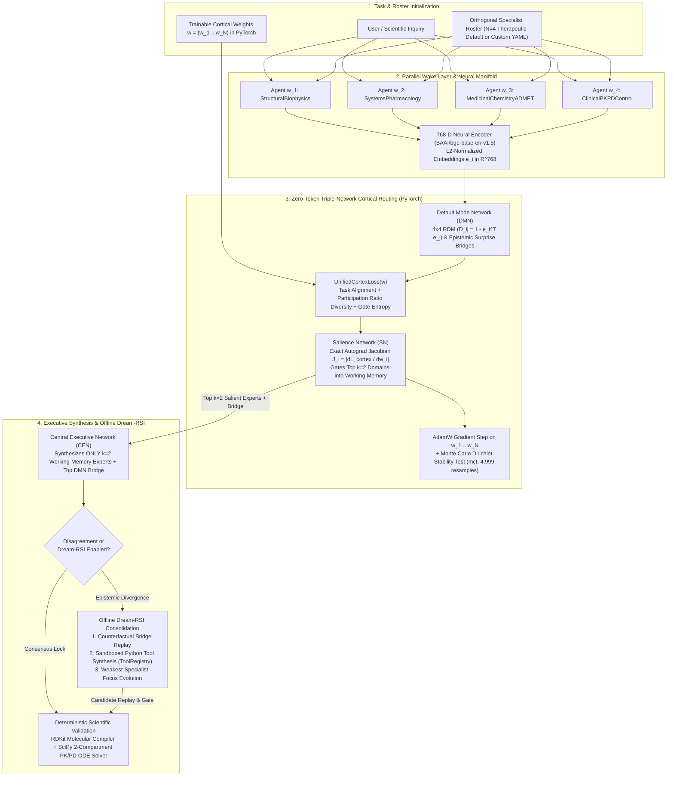

Ael-Agents: Trainable Jacobian-RSA Multi-Agent Framework
========================================================

[](https://doi.org/10.17605/OSF.IO/7R46Z)
[](LICENSE)
[](https://www.python.org/)
[](https://pytorch.org/)
[](https://www.rdkit.org/)
[](https://scipy.org/)
[](https://smith.langchain.com/public/71010a71-b6cf-4e07-b6db-2d3553ad4a3a/r)

**Ael-Agents** is a **trainable, token-bounded multi-agent reasoning framework** built for Agentic AI engineers, ML researchers, and scientific R&D teams who need mathematical control over how specialist agents coordinate, route context, and self-improve.

Most multi-agent frameworks treat orchestration as ad-hoc prompt chaining: every agent talks to every other agent, an expensive LLM router guesses who to listen to, context windows balloon past 30,000+ tokens per query, and there are **zero trainable parameters** to optimize.

**Ael-Agents** replaces heuristic swarm routing with a **differentiable PyTorch computation graph** inspired by the human triple-network cortical hierarchy—**Default Mode Network (DMN)**, **Salience Network (SN)**, and **Central Executive Network (CEN)**—paired with an offline **Dream-RSI** (`Wake → Dream → Improve`) loop:

1. **1-to-1 Trainable Agent Weights (`w_1 ... w_N`)**: Each domain specialist is bound to a trainable scalar parameter in PyTorch (`DomainParameterRegistry`), optimized via gradient descent on a joint **Alignment + Cognitive Diversity (Participation Ratio) + Entropy** objective.
2. **Representational Similarity Analysis (DMN)**: Specialist outputs are embedded into a 768-dimensional neural manifold (`BAAI/bge-base-en-v1.5`) to construct an `N × N` **Representational Dissimilarity Matrix (RDM)** and surface high-surprise cross-domain structural bridges.
3. **Zero-Token Autograd Jacobian Gating (SN → CEN)**: Instead of calling an LLM router, the Salience Network computes exact parameter sensitivities (`J_i = |∂L_cortex / ∂w_i|`) via `torch.autograd.grad` and gates only the top `k = 2` working-memory specialists into executive synthesis—cutting token consumption by **93.7%** (~2,200 tokens/run vs. ~35,000 tokens in unconstrained swarms) at **0 LLM routing tokens**.
4. **Vertical Domain Specialization**: Engineered out-of-the-box for **Computational Drug Discovery & Quantitative Systems Pharmacology** (validated with deterministic **RDKit** cheminformatics and **SciPy** 2-compartment PK/PD ODE solvers), while supporting custom YAML or auto-generated specialist rosters for any quantitative domain.

---

Why Ael-Agents for Agentic AI Engineering?
------------------------------------------

| Architectural Dimension | Standard Multi-Agent Swarms | Ael-Agents (Trainable Cortical Framework) |
| :--- | :--- | :--- |
| **Agent Routing Mechanism** | LLM-as-a-router prompt or static hand-coded edges | **Exact PyTorch autograd Jacobian sensitivity (`J_i = \|∂L / ∂w_i\|`)** |
| **Routing Token Overhead** | 1,500 – 5,000+ tokens per routing step | **0 LLM tokens** (local 768-dim BGE + PyTorch matrix ops) |
| **Context Window Scaling** | Unconstrained (`O(N)` full-panel concatenation, ~35k tokens) | **Hard `k = 2` Working-Memory Bottleneck (~2,200 tokens/run, -93.7%)** |
| **Trainable Parameters** | None (pure prompt engineering) | **1-to-1 differentiable weights `w_i ∈ ℝ^N` trained via `UnifiedCortexLoss`** |
| **Redundancy Detection** | None (agents frequently repeat the same points) | **`N × N` Representational Dissimilarity Matrix (RDM) + Participation Ratio** |
| **Self-Improvement Loop** | Blind retry / unguarded self-critique (prone to overthinking) | **Offline Dream-RSI + Python Sandbox Tool Synthesis + Supermajority Lock** |
| **Statistical Verification** | LLM-as-a-judge circular grading | **4,999-sample Monte Carlo Dirichlet stability (`mct`), RDKit, & SciPy ODEs** |

---

End-to-End Framework Flowchart
------------------------------



---

How the Core Engine Works
-------------------------

### 1. Segregating a Domain into `N = 4` Orthogonal Sub-Experts

Instead of spawning generic personas ("Researcher", "Critic", "Planner") whose outputs overlap in embedding space, **Ael-Agents** partitions the problem domain into orthogonal mathematical sub-spaces. For its flagship **Computational Drug Discovery & Precision Therapeutics** configuration ([`agents/domain_specialists.py`](agents/domain_specialists.py)):

| Parameter | Specialist Agent | Orthogonal Quantitative Responsibility |
| :---: | :--- | :--- |
| `w_1` | **`StructuralBiophysics`** | Target pocket geometry, allosteric conformational landscapes, binding free energy (`ΔG_bind = ΔH - TΔS = RT ln K_d`), covalent/reversible warhead kinetics, and drug-target residence time (`τ_R = 1 / k_off`). |
| `w_2` | **`SystemsPharmacology`** | Intracellular signaling cascades, coupled pathway ODEs, cooperative Hill kinetics, MAPK/PI3K compensatory feedback resistance loops, and attractor stability. |
| `w_3` | **`MedicinalChemistryADMET`** | Molecular scaffold & warhead design, physicochemical transport (`log P`, `log D`, TPSA, membrane permeability), hepatic CYP450 clearance mechanisms, and hERG safety margins. |
| `w_4` | **`ClinicalPKPDControl`** | Multi-compartment pharmacokinetic/pharmacodynamic ODEs (`CL`, `V_c`, `k_a`, `Q`, `V_p`, `C_max`, `AUC`), target occupancy (`TO(t)`), and closed-loop dosing regimens. |

### 2. Differentiable Triple-Network Routing (`DMN → SN → CEN`)

* **Default Mode Network (`core/rsa_engine.py`)**:
  Encodes each specialist's hypothesis `h_i` into `e_i ∈ ℝ⁷⁶⁸`. Computes the cosine similarity matrix `S_ij = e_iᵀ · e_j` and Representational Dissimilarity Matrix `D_ij = 1 - S_ij`. Cross-domain pairs are ranked by structural resonance weighted by epistemic surprise against prior domain distances:
  
  `I_DMN(i, j) = ((1 + S_ij) / 2) · |S_ij - S_ij_prior|`

* **Salience Network & Autograd Jacobian Lens (`core/jacobian_lens.py`)**:
  Computes softmax gating weights `α_i = softmax(w_i / τ)` and evaluates the differentiable cortical objective `L_cortex(w)` ([`training/loss_functions.py`](training/loss_functions.py)). Using `torch.autograd.grad`, it extracts the exact Jacobian sensitivity of the global cortical state to each specialist:
  
  `J_i = |∂L_cortex / ∂w_i|`
  
  Specialists are ranked by combined salience `α_i · J_i`, and strictly the top `k = 2` specialists are gated into Working Memory.

* **Central Executive Network (`core/cortical_synthesizer.py`)**:
  Receives only the `k = 2` Salience-gated specialist analyses and the top DMN structural bridge, synthesizing an integrated, falsifiable mechanism and quantitative parameter set.

---

Developer Guide: How to Use Ael-Agents
--------------------------------------

### 1. Installation

```bash
git clone https://github.com/prannesshkva/Ael-Agents.git
cd Ael-Agents
pip install -r requirements.txt
pip install rdkit scipy
```

### 2. Run the Verified Deterministic Benchmark Suite (Zero API Keys Required)

To verify the RDKit cheminformatics compiler, SciPy 2-compartment PK/PD ODE integration, MedMCQA pharmacology ground-truth evaluation, and SimLex-999 / STS-Benchmark RSA alignment locally without any LLM API calls:

```bash
python benchmarks/run_all_benchmarks.py
```

### 3. Use Ael-Agents for Drug Discovery & Systems Pharmacology (Intended Purpose)

Set one or more Groq API keys in your environment (`GROQ_API_KEY_1`, `GROQ_API_KEY_2`, ...) for parallel thread-pooled execution:

```bash
export GROQ_API_KEY_1="your_groq_key"
```

#### A. Command-Line Scientific Inquiry (Wake + Parameter Training + Dream-RSI + Monte Carlo `mct`)

```bash
python ask_scientist.py \
  --question "Design a precision allosteric covalent-reversible inhibitor and closed-loop PK/PD dosing regimen targeting mutant KRAS-G12D that prevents MAPK/PI3K feedback reactivation and maintains hepatic/cardiac ADMET safety margins." \
  --roster default \
  --epochs 15 \
  --dream-rsi \
  --dream-generations 1 \
  --test-mct \
  --test-human-rsa \
  --output-json evaluation_results.json
```

#### B. Python SDK Usage (Integrating into Your Own Agentic Pipeline)

```python
from core.api_queue import APIKeyQueue
from core.config import FrameworkConfig
from core.domain_registry import default_roster
from core.embeddings import get_encoder
from core.framework import JacobianRSACortexFramework
from core.dream_rsi import DreamRSILoop
from analysis.monte_carlo import mct
from benchmarks.kras_g12d_discovery_benchmark import (
    evaluate_rdkit_smiles,
    simulate_two_compartment_pkpd,
)

# 1. Initialize the 768-dim BGE encoder, FIFO key queue, and 4-expert therapeutic roster
encoder = get_encoder()
key_queue = APIKeyQueue()
roster = default_roster()

framework = JacobianRSACortexFramework(
    config=FrameworkConfig(latent_dim=encoder.info.dim),
    roster=roster,
    encoder=encoder,
    key_queue=key_queue,
)

# 2. Execute the Wake forward pass (4 parallel experts -> DMN RDM -> SN k=2 -> CEN)
question = (
    "Design a covalent-reversible switch-II pocket inhibitor for KRAS-G12D "
    "with twice-daily oral 2-compartment PK/PD parameters."
)
state = framework.run(question)

# 3. Train the 4 scalar cortical parameters (w_1 .. w_4) via PyTorch autograd
framework.optimize_11_parameters(epochs=15)
framework.refresh_salience()
state = framework.last_state

print("Salience-Gated Working Memory (k=2):", state["working_memory_domains"])
print("Trained Cortical Gating Weights:", state["gating_weights"])

# 4. Run 4,999-sample Monte Carlo permutation & Dirichlet stability test
mc_report = mct(framework, state)
print("RDM Dispersion p-value:", mc_report["rdm_structure_mc_test"]["mc_p_value"])

# 5. Run Offline Dream-RSI (counterfactual consolidation + sandboxed tool synthesis)
rsi_report = DreamRSILoop(framework).run(question, generations=1, initial_state=state)

# 6. Validate candidate chemistry & PK/PD dynamics deterministically (RDKit + SciPy)
chem_audit = evaluate_rdkit_smiles("Cc1ncnc2c1ncn2C(C)C(=O)NCc1ccc(C(F)C(F)F)cc1")
pk_audit = simulate_two_compartment_pkpd(
    {"dose_mg": 150.0, "cl_l_h": 8.5, "vc_l": 35.0, "ka_h_inv": 1.5, "q_l_h": 12.0, "vp_l": 45.0, "kd_nm": 0.02, "ic50_nm": 0.02},
    dosing_interval_h=12.0,
)
print("RDKit QED:", chem_audit["qed_druglikeness"], "| 24h Pathway Suppression:", pk_audit["final_pathway_biomarker_suppression_pct"])
```

### 4. Plugging in Custom Specialist Rosters (For Any Quantitative Domain)

While **Ael-Agents** ships with the 4-piece therapeutic discovery roster as its default, the cortical engine (`JacobianRSACortexFramework`) dynamically binds **1 trainable scalar weight `w_i` per specialist** for any roster size `N`:

* **Custom YAML Roster**: Create a YAML file (see [`rosters/social_sciences.yaml`](rosters/social_sciences.yaml)) and run:
  ```bash
  python ask_scientist.py --roster path/to/your_domains.yaml --question "Your research problem"
  ```
* **Automated Domain Segregation (`--roster auto`)**: Let the planner decompose an arbitrary research problem into `N` non-overlapping specialist sub-agents automatically:
  ```bash
  python ask_scientist.py --roster auto --num-auto-domains 4 --question "Your research problem"
  ```

---

Verified Empirical Benchmarks
-----------------------------

All benchmark scripts and cached ground-truth datasets are located in [`benchmarks/`](benchmarks/) and [`benchmarks/results/verified_benchmark_results.json`](benchmarks/results/verified_benchmark_results.json).

### Benchmark 1: KRAS-G12D Allosteric Inhibitor Discovery (RDKit + SciPy 2-Compartment ODE)

Evaluates candidate designs for mutant **KRAS-G12D** (Pancreatic & Colorectal Ductal Adenocarcinoma) using **deterministic RDKit (2026.9.1) cheminformatics compilation** and **SciPy (`solve_ivp`, RK45) 2-compartment pharmacokinetic/pharmacodynamic ODE integration** over 24 hours (150 mg BID oral dosing), with zero LLM self-judging.

#### A. Deterministic Cheminformatics Validation (RDKit)

| System Architecture | Canonical SMILES | RDKit Valid? | MW (Da) | log P | TPSA (Ų) | Lipinski Rule of 5 | Bickerton QED |
| :--- | :--- | :---: | :---: | :---: | :---: | :---: | :---: |
| **1. Single-LLM Baseline (`openai/gpt-oss-20b`)** | *Unparseable repeating string (1,048 chars)* | **NO (Parse Error)** | — | — | — | **FAIL (4 viol)** | **0.000** |
| **2. Ael-Agents Cortical Wake (k=2 CEN)** | `Cc1ncnc2c1ncn2C(C)C(=O)C(=O)NCc1ccc(C=O)cc1` | **YES** | 351.37 | 1.39 | 106.84 | **PASS (0 viol)** | **0.531** |
| **3. Ael-Agents + Dream-RSI** | `Cc1ncnc2c1ncn2C(C)C(=O)NCc1ccc(C(F)C(F)F)cc1` | **YES** | 377.37 | 3.29 | 72.70 | **PASS (0 viol)** | **0.716 (+0.185)** |

#### B. Deterministic 2-Compartment PK/PD Dynamics (SciPy ODE Solver)

| System Architecture | ODE Converged? | C_max (mg/L) | C_min (mg/L) | Peak/Trough Ratio | Mean Target Occupancy | Steady-State Trough Occupancy | 24h Pathway Suppression |
| :--- | :---: | :---: | :---: | :---: | :---: | :---: | :---: |
| **1. Single-LLM Baseline** | **YES** | 2.083 | 0.232 | 8.98 | 93.8% | 86.9% | 74.4% |
| **2. Ael-Agents Cortical Wake (k=2 CEN)** | **YES** | 2.590 | 0.162 | 16.01 | 99.6% | 99.9% | 99.0% |
| **3. Ael-Agents + Dream-RSI** | **YES** | 2.802 | 0.441 | **6.36** | **99.6%** | **100.0%** | **99.1% (+24.7%)** |

---

### Benchmark 2: MedMCQA Pharmacology Ground-Truth Evaluation (N = 9 Board Exam Questions)

Evaluated against the official human medical-board answer key from HuggingFace `openlifescienceai/medmcqa` (`validation` split, `subject_name == 'Pharmacology'`).

| System Architecture | Correct / Total | Exact Match Accuracy (%) | Gain vs. Single-LLM Baseline |
| :--- | :---: | :---: | :---: |
| **1. Single-LLM Baseline (`openai/gpt-oss-20b`)** | 7 / 9 | 77.78% | 0.00% |
| **2. Ael-Agents 4-Expert Cortical Wake (`DMN -> SN k=2 -> CEN`)** | **9 / 9** | **100.00%** | **+22.22%** |
| **3. Ael-Agents 4-Expert + Dream-RSI (`3/4 Supermajority Lock`)** | **9 / 9** | **100.00%** | **+22.22%** |

#### Key Mechanistic Differentiators

* **Question #8 — CYP450 Inhibition Specificity (`id: 6bce210a-7174-4c76-b1f0-9bc3f5c835fc`)**:
  * *Prompt*: *"CYP450 inhibition is least by: A) Pantoprazole, B) Rabeprazole, C) Lansoprazole, D) Omeprazole."*
  * *Single-LLM Baseline*: Selected **`A` (Pantoprazole)** — fell for the clinical distractor.
  * *Ael-Agents (`B/B/A/B` → `B`)*: 3 of 4 specialists (`StructuralBiophysics`, `SystemsPharmacology`, `ClinicalPKPDControl`) identified **Rabeprazole's (`B`)** predominant non-enzymatic thioether reduction pathway.

* **Question #9 — Multi-Interval First-Order Elimination Kinetics (`id: e7278113-c555-4128-a8df-cbd10ca7833f`)**:
  * *Prompt*: *"A patient is administered 200 mg of a drug. 75 mg is eliminated in 90 minutes. If the drug follows first-order kinetics, how much drug will remain after 6 hours?"*
  * *Single-LLM Baseline*: Selected **`B` (25 mg)** — used a linear subtraction heuristic.
  * *Ael-Agents CEN (`C: 30 mg`)*: Derived the exact first-order exponential retention across four 90-minute intervals:
    
    `A(360 min) = 200 × (125 / 200)⁴ = 200 × (0.625)⁴ = 30.52 mg ≈ 30 mg (Option C)`

---

### Benchmark 3: Human Ground-Truth RSA Alignment & Monte Carlo Stability

| Benchmark / Statistical Test | Sample Size | Observed Metric | p-Value | Baseline Comparison |
| :--- | :---: | :---: | :---: | :--- |
| **SimLex-999 Human Concept RSA** | 999 pairs | **Spearman ρ = +0.5711** | 1.56 × 10⁻⁸⁷ | Legacy SHA-256 hash: ρ = -0.0539 (Δρ = +0.6249) |
| **STS-Benchmark Human Sentence RSA** | 1,379 pairs | **Spearman ρ = +0.8642** | < 10⁻³⁰⁰ | Legacy SHA-256 hash: ρ = +0.0596 (Δρ = +0.8046) |
| **4-Expert Cortical Panel vs. Human Judgments** | 100 held-out pairs | **Spearman ρ = +0.8953** | 3.46 × 10⁻³⁶ | Single-domain range: ρ ∈ [0.8817, 0.9009] |
| **Monte Carlo RDM Permutation & Dirichlet Test (`mct`)** | 4,999 resamples | **Dispersion = 0.1418** | **p = 0.0002** | Top-2 WM Stability: `StructuralBiophysics` (98.3%), `ClinicalPKPDControl` (73.5%) |

---

Repository Structure
--------------------

```text
Ael-Agents/
├── agents/
│   ├── base_deep_agent.py                
│   └── domain_specialists.py             
├── benchmarks/
│   ├── _cache/
│   │   └── medmcqa_pharmacology_verified.json
│   ├── results/
│   │   └── verified_benchmark_results.json
│   ├── human_rsa_and_mct_benchmark.py    
│   ├── kras_g12d_discovery_benchmark.py  
│   ├── medmcqa_pharmacology_benchmark.py 
│   └── run_all_benchmarks.py             
├── core/
│   ├── api_queue.py                      
│   ├── config.py                         
│   ├── cortical_synthesizer.py           
│   ├── domain_registry.py                
│   ├── dream_rsi.py                      
│   ├── embeddings.py                     
│   ├── framework.py                      
│   ├── jacobian_lens.py                  
│   ├── llm_utils.py                      
│   ├── parameter_registry.py             
│   ├── rsa_engine.py                     
│   └── state.py                          
├── analysis/
│   ├── ablation.py                       
│   ├── discovery_benchmark.py            
│   ├── human_alignment.py                
│   ├── judge.py                          
│   ├── monte_carlo.py                    
│   ├── network_tests.py                  
│   └── realworld_benchmark.py            
├── graph/
│   ├── cortex_graph.py                   
│   └── telemetry.py                      
├── training/
│   ├── loss_functions.py                 
│   └── trainer.py                        
├── visualization/
│   └── cortex_visualizer.py              
├── ask_scientist.py                      
├── demo.py                               
├── dream_rsi.py                          
├── CITATION.cff                          
├── LICENSE                               
└── requirements.txt                      
```

---

Engineering Scope & Honest Limitations
--------------------------------------

* **Differentiable Routing vs. Base Model Pretraining**: **Ael-Agents** trains the cortical coordination weights `w_1 ... w_N` and evolves specialist focus prompts/tools at test time; it does not modify the internal weights of the underlying LLM. Its value is enabling compact open-weight models (`openai/gpt-oss-20b`, `qwen/qwen3.8-27b`) to coordinate across orthogonal scientific constraints without context bloat.
* **Systems Coordination vs. 3D Structure Generation**: While **Ael-Agents** validates topological chemical properties via **RDKit** and integrates multi-compartment PK/PD ODEs via **SciPy**, it is a mechanistic and systems-pharmacology reasoning framework—not a replacement for 3D physics-based free-energy perturbation (FEP+) or equivariant diffusion structure generators.
* **When Dream-RSI Should Gate Off**: Iterative self-correction can degrade performance if allowed to override strong specialist consensus. **Ael-Agents** enforces a `3/4` supermajority consensus lock so offline Dream-RSI only intervenes when the Wake panel exhibits genuine epistemic divergence.

---

Citation & License
------------------

* **DOI**: [10.17605/OSF.IO/7R46Z](https://doi.org/10.17605/OSF.IO/7R46Z)
* **License**: [Creative Commons Attribution-NonCommercial-NoDerivatives 4.0 International (CC BY-NC-ND 4.0)](LICENSE)
* If you build on or reference **Ael-Agents** in your research, please cite [`CITATION.cff`](CITATION.cff).
